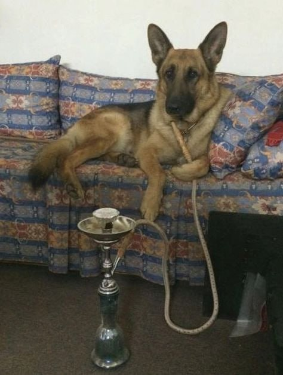

# labs
---
* Валов Илья Игоревич

* ИВТ-26-2Б

| № | Название | Срок | Статус|
|---|----------|------|-------|
| 0 | Git/Github | 17.09.26 - 22.09.26 | ЗАВЕРШЕНО |
| 1 | Знакомство с Си++. Выполнение программы простой структуры| 6.10 - 8.10 | ЗАВЕРШЕНО|
| 2 | Использование основных операторов языка Си | 16.10 - 20.10 | ЗАВЕРШЕНО|
| 3 | Вычисление функций с использованием их разложения в степенной ряд | 27.10 - 3.11 | ЗАВЕРШЕНО |
| 4 | Работа с одномерными массивами | 29.10 - 3.11 | ЗАВЕРШЕНО |
